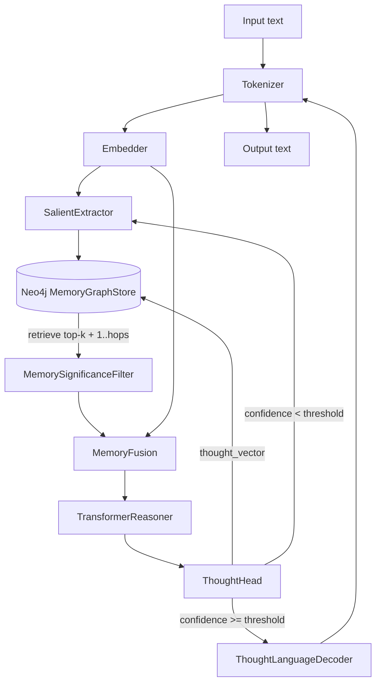

## Architecture



The `CognitiveEngine` orchestrates the loop: every iteration retrieves linked memory, fuses it with the current input/thought, reasons over it, emits a new thought, writes it back to the graph with weighted links to the memory units it consumed, reinforces those edges (Hebbian-style), and stops once `confidence >= threshold` or `max_iterations` is hit. Then the final thought is decoded to tokens.

## Folder layout (extends existing `base/`+`modules/` convention)

```
crane/
  language/                                 (existing)
    tokenization/{base,modules}             # + modules/char_tokenizer.py (minimal demo)
    embeddings/{base,modules}               # + modules/lookup_embedder.py (minimal demo)
  neural/
    salient/
      base/extractor.py                     # SalientExtractor(ABC, nn.Module)
      modules/attention_pool_extractor.py
    fusion/
      base/fusion.py                        # MemoryFusion(ABC, nn.Module)
      modules/cross_attention_fusion.py
    reasoning/
      base/reasoner.py                      # Reasoner(ABC, nn.Module)
      modules/transformer_reasoner.py
    thought/
      base/thought_head.py                  # ThoughtHead(ABC, nn.Module)
      modules/linear_thought_head.py
    decoder/
      base/decoder.py                       # ThoughtLanguageDecoder(ABC, nn.Module)
      modules/transformer_thought_decoder.py
  memory/
    graph/
      base/
        types.py                            # MemoryNode / MemoryEdge / RetrievalResult dataclasses
        store.py                            # MemoryGraphStore(ABC)
        significance.py                     # MemorySignificanceFilter(ABC)
      modules/
        neo4j_store.py                      # Neo4jMemoryGraphStore
        activation_significance.py          # default scorer
  cognition/
    engine/
      base/engine.py                        # CognitiveEngine(ABC) + EngineConfig
      modules/iterative_engine.py           # IterativeCognitiveEngine
pipelines/
  main.py                                   # wires demo loop with random weights
```

After creation, run `uv run generate-init` to refresh every `__init__.py` via [cli/scripts/generate_inits.py](cli/scripts/generate_inits.py).

## Key contracts

### Memory (the heart of cognition)

`crane/memory/graph/base/types.py` — dataclasses:
- `MemoryNode(id, vector: Tensor (D,), payload: dict, activation: float)`
- `MemoryEdge(source_id, target_id, weight, last_used)`
- `RetrievalResult(nodes, edges, vectors: Tensor (N,D), similarities: Tensor (N,), node_ids: list[str])`

`crane/memory/graph/base/store.py` — `MemoryGraphStore(ABC)`:
- `retrieve(query: Tensor (D,), k: int, hops: int) -> RetrievalResult` — vector search + 1..hops graph expansion.
- `write(vectors: Tensor (B,D), payload: list[dict], links: list[tuple[str, str, float]]) -> list[str]` — insert new memory nodes with weighted links to existing nodes (e.g. the retrieved ones that produced this thought).
- `reinforce(edge_updates: list[tuple[str, str, float]]) -> None` — Hebbian-style: bump edges between co-activated nodes proportional to delta.
- `decay(factor: float) -> None` — multiplicative weight decay so unused links fade.

### Neo4j 5.x driver (the chosen "best ready solution")

`crane/memory/graph/modules/neo4j_store.py` — `Neo4jMemoryGraphStore(MemoryGraphStore)`:

Schema:
- Node label `MemoryUnit { id, vector: list[float], payload, created_at, activation }`
- Edge type `[:ASSOCIATED_WITH { weight, last_used }]`
- Vector index created on first connect:

```cypher
CREATE VECTOR INDEX memory_vectors IF NOT EXISTS
FOR (n:MemoryUnit) ON (n.vector)
OPTIONS {indexConfig: {`vector.dimensions`: $dim, `vector.similarity_function`: 'cosine'}}
```

Retrieval (Neo4j 5.x procedure form):

```cypher
CALL db.index.vector.queryNodes('memory_vectors', $k, $vector)
YIELD node, score
OPTIONAL MATCH (node)-[r:ASSOCIATED_WITH*1..$hops]-(m:MemoryUnit)
RETURN node, score, collect(distinct m) AS neighbors, collect(distinct r) AS edges
```

Reinforcement (Hebbian update for co-activated edges):

```cypher
UNWIND $updates AS u
MATCH (a:MemoryUnit {id: u.src})-[r:ASSOCIATED_WITH]-(b:MemoryUnit {id: u.dst})
SET r.weight = r.weight + u.delta, r.last_used = timestamp()
```

Adds `neo4j>=5.20` to `pyproject.toml` dependencies. URI/auth/dim read from constructor args (no implicit env coupling in the base library).

### Neural skeletons (all `nn.Module` + subclass of their respective ABC)

- `AttentionPoolSalientExtractor` — `K` learnable slot queries cross-attend over `(B,T,D)` token embeddings → `(B,K,D)` salient slots.
- `CrossAttentionMemoryFusion` — input tokens query over retrieved memory `(B,M,D)` with significance-weighted attention bias `log(weights)`; gated residual back into tokens. Output: `(B,T,D)`.
- `MemorySignificanceFilter` (ABC) + `ActivationSignificance` — combines similarity, mean inbound edge weight from the activated set, and recency into a scalar per candidate; top-M selected.
- `TransformerReasoner` — `nn.TransformerEncoder` stack over fused tokens with a learnable `[CLS]`-like state token; outputs `(B,D)` reasoning state.
- `LinearThoughtHead` — projects state to `thought_vector` (tanh) and `confidence` (sigmoid scalar per batch element).
- `TransformerThoughtDecoder` — `nn.TransformerDecoder` with the (projected) thought vector as `memory`, autoregressive `generate(thought, bos, eos, max_len)` greedy/sampled. Conceptually: thought (continuous cognition) → tokens (language interface).

### Engine

`crane/cognition/engine/base/engine.py`:

```python
@dataclass(frozen=True)
class EngineConfig:
    confidence_threshold: float = 0.85
    max_iterations: int = 8
    memory_top_k: int = 32
    memory_keep_m: int = 8
    memory_hops: int = 2
    reinforce_delta: float = 0.05
    decay_factor: float = 0.999

class CognitiveEngine(ABC):
    @abstractmethod
    def think(self, text: str) -> str: ...
```

`crane/cognition/engine/modules/iterative_engine.py` — `IterativeCognitiveEngine.think` pseudocode:

1. `ids = tokenizer.encode(text)`; `x = embedder.embed_tokens(ids)`
2. Loop up to `max_iterations`:
   - `salient = salient_extractor(x_or_thought_injected)` → `(B,K,D)`
   - `result = memory.retrieve(salient.mean(1), k=top_k, hops=hops)`
   - `scores = significance.score(salient.mean(1), result)`; pick top-M → `mem_vectors`, `mem_weights`
   - `fused = fusion(x, mem_vectors, mem_weights)`
   - `state = reasoner(fused)`
   - `thought, confidence = thought_head(state)`
   - `new_ids = memory.write(thought, payload=[{"step": i}], links=[(used_id, "<new>", w) for ...])`
   - `memory.reinforce(edge_updates between all co-activated used nodes)`
   - inject `thought` back into `x` (e.g. prepend as virtual token) for next iter
   - break if `confidence.mean() >= threshold`
3. `out_ids = decoder.generate(thought, bos, eos, max_len)`; `return tokenizer.decode(out_ids)`

### Demo wiring

`pipelines/main.py` instantiates `CharTokenizer`, `LookupEmbedder(nn.Embedding)`, all neural skeletons with small dims (e.g. `D=64`, 2 layers, 4 heads), a `Neo4jMemoryGraphStore(uri, auth, dim=64)`, builds `IterativeCognitiveEngine`, and calls `engine.think("hello")`. Running it requires a local Neo4j 5.x instance; otherwise the engine raises a clear error at `_ensure_schema`. (No training in this skeleton — random weights, `torch.no_grad`.)

## Dependency changes

- Add `neo4j>=5.20` to `[project].dependencies` in [pyproject.toml](pyproject.toml).

## Notes / non-goals

- No training / no losses — purely architectural skeleton with runnable forward path.
- Memory weight semantics (`weight` on `ASSOCIATED_WITH`) follow the README principle "learning is process of updating memory-units connections": reinforce on co-activation, decay globally per call.
- Significance filter is a strategy object so alternative scoring (pure-similarity / recency-weighted / learned-MLP) can be swapped without changing the engine.
- All new files follow the existing auto-export rule; `uv run generate-init` is run at the end so every `__init__.py` is regenerated correctly.